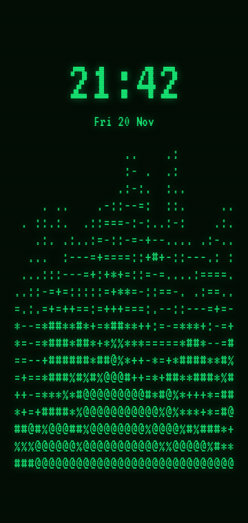
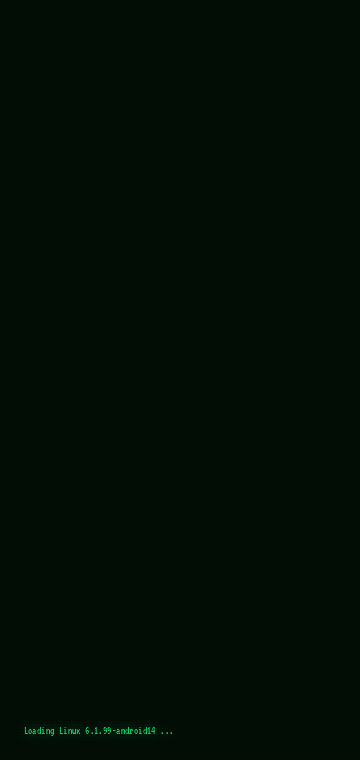
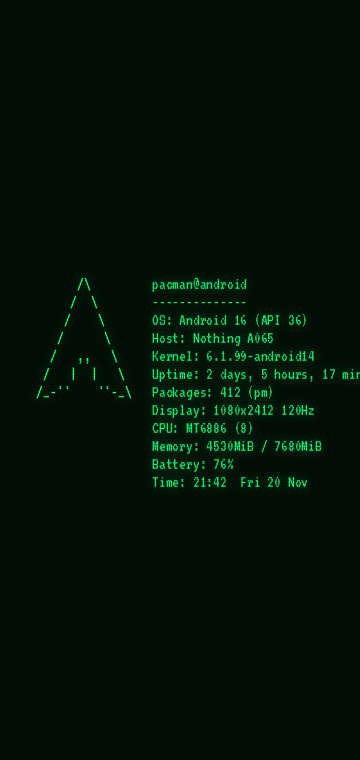
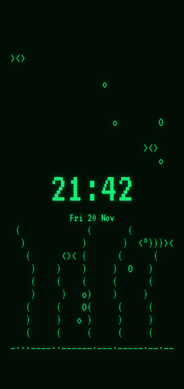

# DroidTTY

**An Android launcher that turns the phone into a terminal.**

Your apps as a short list of text entries, in front of a live readout of the phone: status rows,
process and connection tables, a scrolling event log. Around it: an always-on display with animated
ASCII looks, lock screens that boot like a PC, and a notification shade drawn in ASCII boxes. Everything
can be dressed as an old CRT, or left plain.

DroidTTY is a fork of [AndSni's SysReadout Launcher](https://github.com/AndSni/SysReadout-Launcher),
which built the launcher, the log and the system monitor. This fork adds the always-on display, lock
screens, shade and the Shizuku fallback described below.

<p>




</p>

**[See every look and preset in the gallery ›](docs/GALLERY.md)**

## Features

**Launcher**
- Pinned apps as text entries; a searchable drawer (prefix, initials, substring; opens a single match by itself).
- Gestures: up for apps, down for the notification shade, left/right for an app you choose, double-tap to lock, long-press for settings.
- Hidden apps, renaming, work profiles. Android's status bar, or just its clock, can be hidden.
- Safe mode: should it crash twice right after starting, it comes back as a plain launcher, with the crash report under settings › about.

**Readout**
- 52 optional status rows: CPU, memory, swap, thermal headroom, battery current and watts, network speed, Wi-Fi and mobile signal, IP, storage, build properties, GPU, sensors, sunrise, moon phase and more.
- An editable banner with live placeholders (`{year}`, `{device}`, `{android}`…).
- An event stream: network and power changes, installs, app switches, background services.
- Two layouts: **classic** (rows, tables and stream in fixed places) or **feed** (one list; new lines push old ones off).

**System monitor** (each part optional)
- **[Shizuku](https://shizuku.rikka.app/)**: processes by CPU or memory, every connection per app with server names, wakelocks, per-app battery drain, temperatures, per-core load, system errors from logcat. On phones where Shizuku can't start DroidTTY's helper (some Android 16 ROMs), it falls back to Shizuku's own shell by itself.
- **Usage access**: screen time, unlocks, traffic per app, data this month.
- **Notification access**: a notification log and per-app table, and what's playing.
- **DNS monitor**: a local VPN carrying only DNS, showing which app looks up which server.
- **Location / phone / Bluetooth / activity**: GPS and satellites, serving cell and 5G/LTE-CA details, Bluetooth devices with battery, steps.

**Always-on display** (19 looks)
- Animated ASCII: doom fire, starfield, game of life, spinning cube, rain on glass, aquarium, oscilloscope, pong, plasma, DNA helix, matrix rain.
- Still: minimal clock, terminal status rows, shell prompt, log tail, neofetch, tty clock, htop meters, binary clock.
- Size, brightness, colour, position (top/middle/bottom, left/centre/right, nudges, margins), burn-in shift and timeout. Shows while charging or always, waits for the charger below a battery level, goes dark in a pocket and never shows during calls. Also offered as Android's screen saver.

**Lock screen** (10 presets)
- Arch Linux (GRUB, initramfs hooks, systemd units, login), bootline, BIOS flash, DOS prompt, unix login, GRUB menu, Commodore 64, kernel panic, ssh login, "wake up".
- Built from the phone's real kernel, memory, storage, network and battery; a value the phone doesn't give is left out.
- Either over Android's lock (a tap goes straight to Android's PIN pad and fingerprint), or as DroidTTY's own PIN lock for phones with no Android lock: PBKDF2-hashed PIN, shuffled or standard keypad, escalating lockout, shake and buzz on a wrong PIN, the shade, recents and apps blocked while locked. The own lock has no fingerprint and doesn't encrypt your data; the manual says exactly what it can and can't stop.

**Notification shade**
- ASCII-boxed panels: readout rows; toggles (Wi-Fi, Bluetooth, mobile data, airplane, location, do not disturb, torch, rotation, hotspot, NFC, battery saver, dark mode); Bluetooth devices with battery and connect/disconnect; nearby Wi-Fi networks.
- Draggable brightness with auto-brightness, and media, ring and alarm volume sliders.
- Notifications grouped by app: expand, open, their action buttons, inline reply, snooze 15 min or 1 h, dismiss, clear all. What's playing, with transport controls.
- With Shizuku the toggles switch directly; without it a toggle opens Android's panel for it. `[system shade]` opens Android's own.

**Look**
- 7 presets (green-phosphor and amber DOS terminals among them) plus your own; 11 bundled fonts and your own .ttf/.otf, with size, weight, spacing, case and colour per element.
- CRT effects: glow, scanlines, curvature, vignette, colour fringe, flicker, grain.

Everything is explained in the **[user manual](docs/MANUAL.md)**.

## Install

Download `DroidTTY.apk` from the [latest release](https://github.com/oiupoyt/DroidTTY/releases/latest) (also on [Forgejo](https://git.oiupoyt.space/oiupoyt/DroidTTY/releases)) and open it (allow "install unknown apps"). DroidTTY has its own app id, `space.oiupoyt.droidtty`, so it installs beside SysReadout rather than over it.

Then make it your home screen: **Settings › Apps › Default apps › Home app › DroidTTY**.

Requires Android 8.0 (API 26) or newer; curvature and colour fringe need Android 13.

## Permissions

Nothing beyond the basics is used until you switch on the feature that needs it, and runtime permissions are requested at that moment.

| Permission | Used for | When |
|---|---|---|
| Network state, Wi-Fi state | connection type, IP, Wi-Fi signal rows | install-time, no prompt |
| Change Wi-Fi state | asking for a fresh scan for the *nearby networks* row | install-time |
| Expand status bar | swipe down for Android's notifications | install-time |
| Request delete packages | *uninstall* in the drawer's long-press menu (Android still asks you to confirm) | install-time |
| Set alarm | tapping the clock opens your alarms | install-time |
| Query all packages | real app names for system processes, connections and traffic | install-time |
| Set wallpaper | lock-screen image or log snapshot | only if you choose it |
| Internet | **only** the optional DNS monitor, which relays your apps' own lookups to your network's own DNS servers (no public fallback) | only if you switch it on |
| Usage access | screen time, traffic, app switches | you grant it in Android settings |
| Notification access | notification log, the shade's notifications and media controls | you grant it in Android settings |
| Accessibility (lock service) | double-tap to lock; draws the always-on display, lock screens and shade over other windows; watches which window opens (to replace Android's shade or guard the own lock), never window content | you enable it in Android settings |
| Display over other apps | always-on display and lock cover without the lock service | you grant it in Android settings |
| Foreground service, notifications, wake lock | the fallback screen service, and waking the screen for the always-on display | only if you switch one on |
| Location | GPS, satellites, Wi-Fi name, nearby networks, cell tower, sunrise rows, the shade's Wi-Fi list | asked when you switch one on |
| Phone | 5G/LTE link details, mobile data toggle state | asked when you switch it on |
| Bluetooth connect | connected devices and their battery | asked when you switch it on |
| Physical activity | step count | asked when you switch it on |
| Bluetooth (Android ≤ 11) | reading whether Bluetooth is on | install-time on old Android |

## Privacy

No ads, no analytics, no tracking, no accounts. Everything is read on the phone and kept in memory; nothing is written anywhere except your settings, the own lock's PIN hash (in storage that's never backed up), and, if DroidTTY crashes, the last crash report, which stays on the phone until you share or delete it. The log stops when the home screen isn't visible.

## Build

Requirements: JDK 17 or 21, Android SDK (compileSdk 36).

```sh
./gradlew :app:assembleDebug :app:lintDebug :app:testDebugUnitTest
```

The Gradle root is the repository root; the app module is `app/`. The gallery's images are drawn from the app's own frame code; see [docs/GALLERY.md](docs/GALLERY.md#regenerating).

### Release signing

Release builds are signed from a `keystore.properties` file at the repository root, which is **not** in git:

```properties
storeFile=/absolute/path/to/droidtty-release.p12
storePassword=…
keyAlias=sysreadout
keyPassword=…   # PKCS12 keystores: same as storePassword
```

Without it, `assembleRelease` produces an unsigned APK. CI gets the same values from repository secrets (`RELEASE_KEYSTORE_B64`, `RELEASE_KEYSTORE_PASSWORD`, `RELEASE_KEY_ALIAS`, `RELEASE_KEY_PASSWORD`).

### Releasing a version

1. Bump `versionCode` (+1) and `versionName` in `app/build.gradle.kts`, and add `metadata/en-US/changelogs/<versionCode>.txt`.
2. Push to `main`: CI publishes a rolling `latest` release on GitHub and mirrors it to Forgejo (needs the `FORGEJO_TOKEN` secret).
3. Tag the commit `vX.Y.Z` and push the tag: `release-tag.yml` publishes a permanent release on both.

Signing certificate SHA-256: `39caf48edfbc24d784220093324df2efab10620f457a01ba68a6e1b58ac277e8`

## Credits

- [SysReadout Launcher](https://github.com/AndSni/SysReadout-Launcher) by AndSni, which DroidTTY is built on.
- Fonts (licences in [`app/src/main/assets/licenses`](app/src/main/assets/licenses), also viewable in the app under settings › about):
  JetBrains Mono, IBM Plex Mono, Space Mono, Share Tech Mono, VT323, Major Mono Display, Press Start 2P and Silkscreen under the SIL Open Font License 1.1;
  Px437 IBM VGA 8x16 by VileR ([int10h.org](https://int10h.org/oldschool-pc-fonts/)) under CC BY-SA 4.0.
- [Shizuku](https://github.com/RikkaApps/Shizuku-API) API (MIT), [Haze](https://github.com/chrisbanes/haze) (Apache-2.0), AndroidX and Jetpack Compose (Apache-2.0).
- Inspired by [Olauncher](https://github.com/tanujnotes/Olauncher) and [mLauncher](https://github.com/CodeWorksCreativeHub/mLauncher).

## License

GPL-3.0, see [`LICENSE`](LICENSE).
