# DroidTTY gallery

Every always-on look and lock-screen preset. The images come from the same
frame code the phone runs: a unit test dumps each frame (`GalleryDump`), and
[`tools/gallery.py`](../tools/gallery.py) draws it with the bundled VT323 font
in the *green P1* colours. Values are a sample phone's; yours shows your own. The
phone's CRT shader (curvature, fringe) isn't reproduced; a light scanline overlay
stands in for it, and fonts, colours and size follow your theme on the phone.

Moving looks are GIFs; open one to see it loop.

## Always-on display: animated

| | | | | |
|:-:|:-:|:-:|:-:|:-:|
| 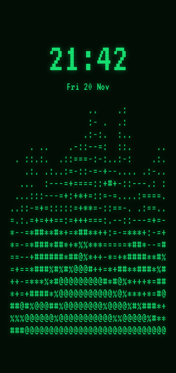 | 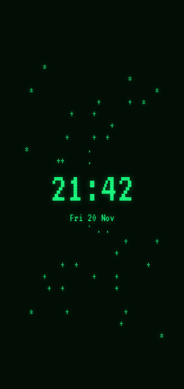 | 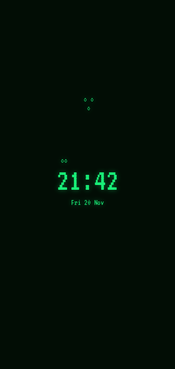 | 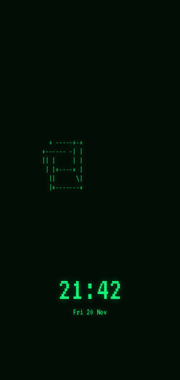 | 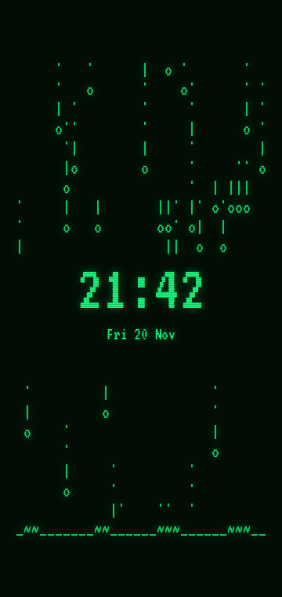 |
| **doom fire**<br>flames licking up under the clock | **starfield**<br>stars streaming out from the centre | **game of life**<br>a new seed every minute | **spinning cube**<br>wireframe, two axes | **rain on glass**<br>drops into a rippling puddle |
| 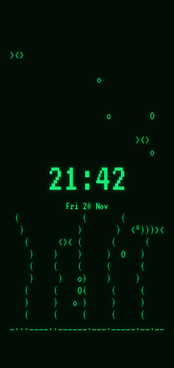 | 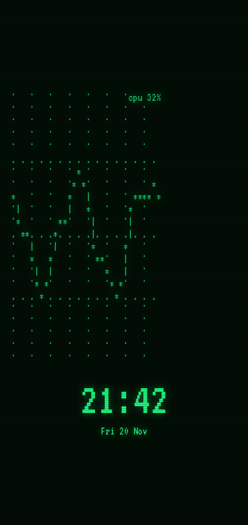 | 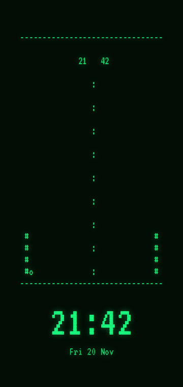 | 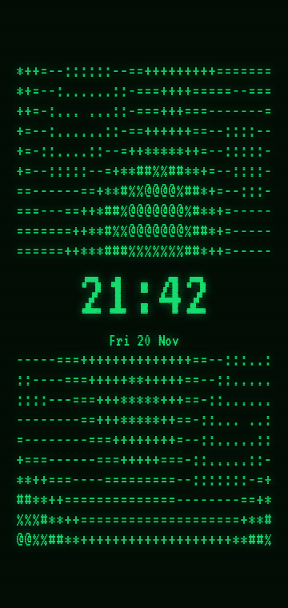 | 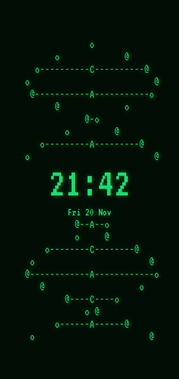 |
| **aquarium**<br>fish, bubbles, seaweed | **oscilloscope**<br>follows cpu load with shizuku | **pong**<br>the score is the time | **plasma**<br>demoscene shading | **dna helix**<br>twisting upward |

## Always-on display: still

| | | | | |
|:-:|:-:|:-:|:-:|:-:|
| 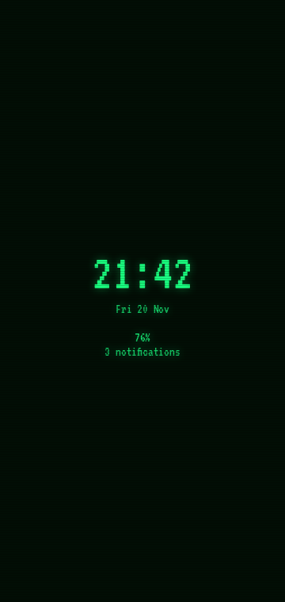 | 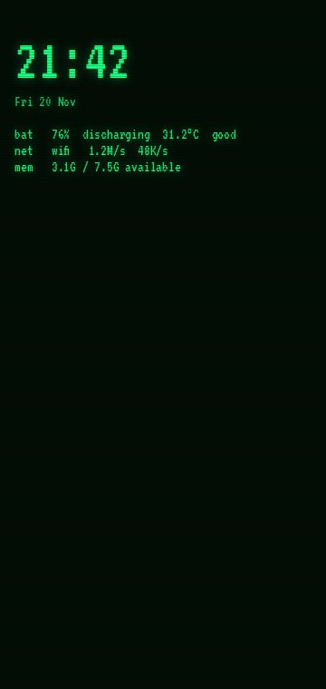 | 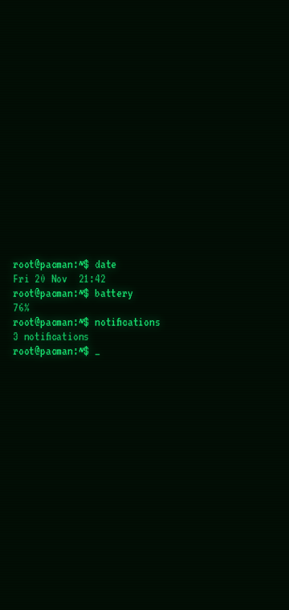 | 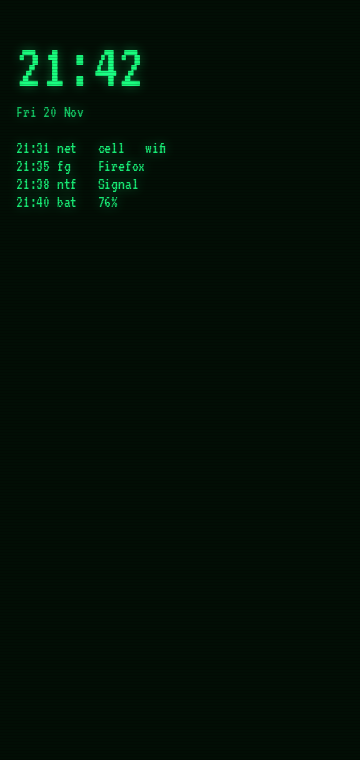 | 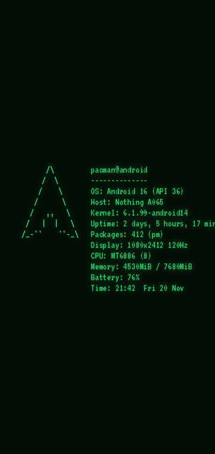 |
| **minimal clock** | **terminal status** | **prompt** | **log tail** | **neofetch** |
| 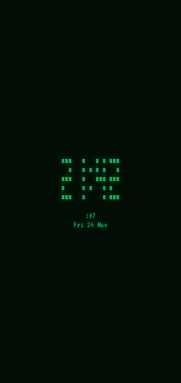 | 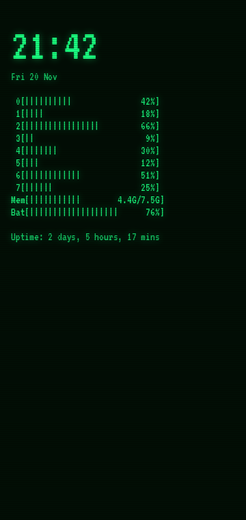 | 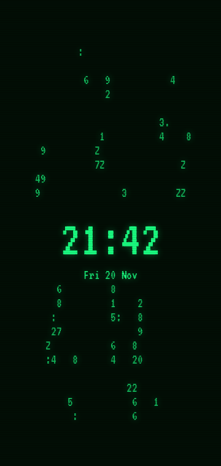 | 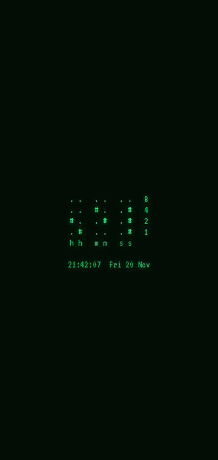 | |
| **tty clock** | **htop meters** | **matrix rain** | **binary clock** | |

## Lock screen presets

Each plays once when the screen turns on, then waits for a tap (or, with
DroidTTY's own lock, the PIN). The GIFs show the whole boot.

| | | | | |
|:-:|:-:|:-:|:-:|:-:|
| 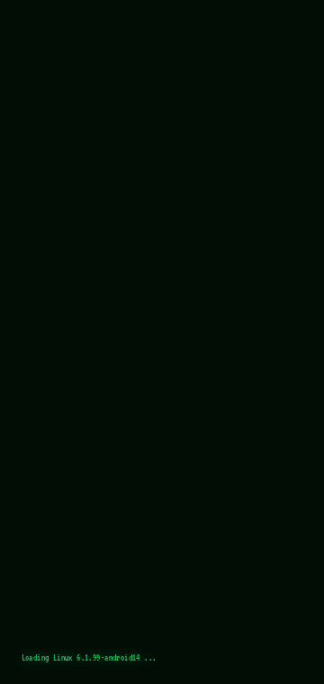 | 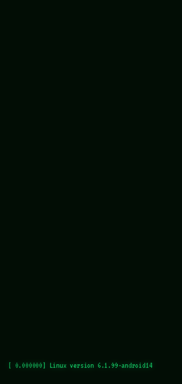 | 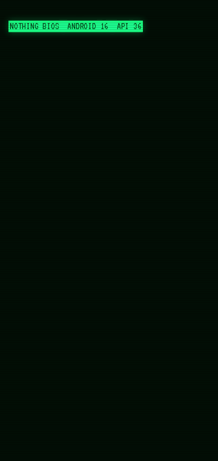 | 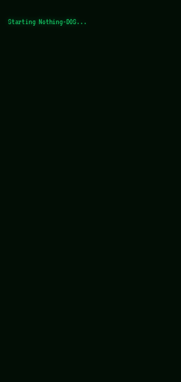 | 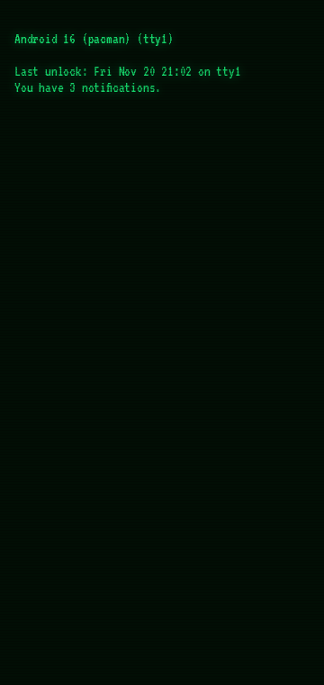 |
| **arch linux** | **bootline** | **bios flash** | **dos prompt** | **unix login** |
|  | 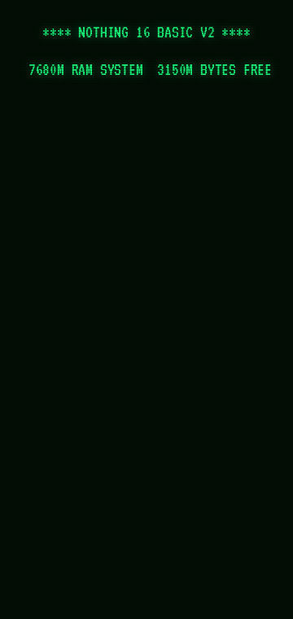 | 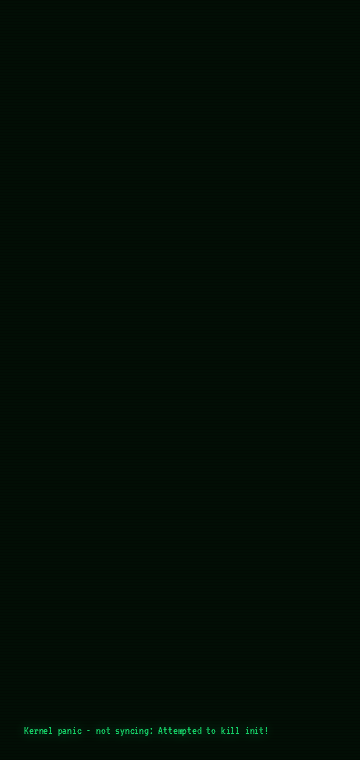 | 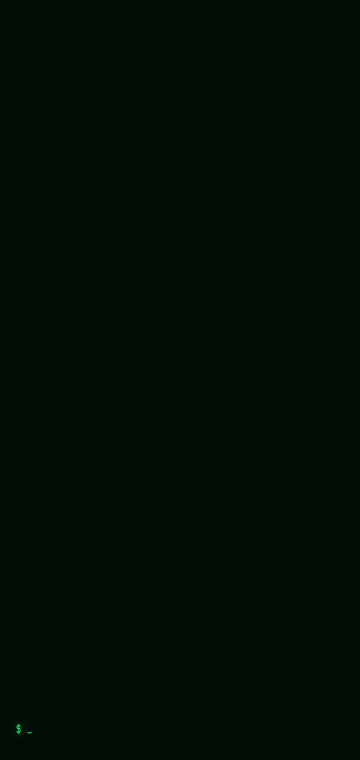 |  |
| **grub menu** | **commodore 64** | **kernel panic** | **ssh login** | **wake up** |

## Regenerating

```sh
./gradlew :app:testDebugUnitTest --tests '*GalleryDump*'   # writes app/build/gallery/frames.json
python3 tools/gallery.py                                    # draws docs/gallery/ (needs Pillow)
```

CI uploads `frames.json` as the `gallery-frames` artifact of every build.
